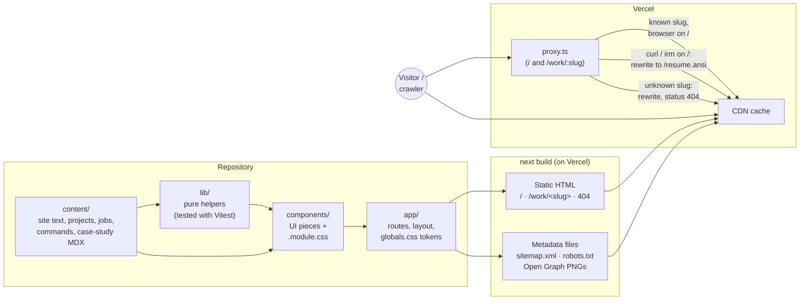
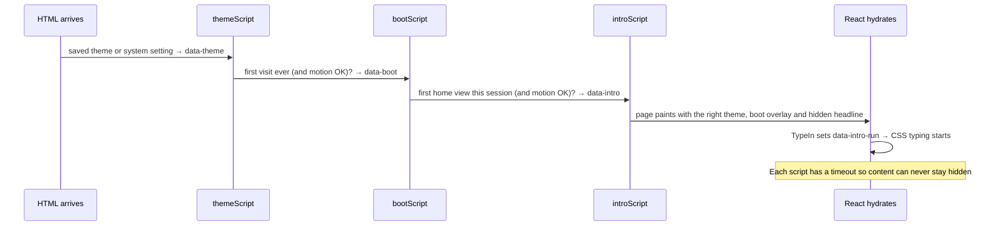

# Architecture

How the portfolio is put together: where content lives, how a page is built and served, and the few moving parts that run in the browser.

The short version: **every page is static.** Content lives in TypeScript and MDX files, Next.js turns it into HTML at build time, and Vercel serves that HTML from its CDN. A small amount of client JavaScript adds the interactive parts (command palette, live terminal, theme toggle, copy buttons). There is no database, no API and no CMS.

## The big picture

## Folders

| Folder | Role | Rule of thumb |
|---|---|---|
| `content/` | Every word on the site, every number, every command | Edit text here, never in components. Each file starts with a "HOW TO EDIT" comment. |
| `lib/` | Small, pure functions: palette filtering, shell matching, typing timings, uptime math, theme and intro switches, site URL, share-image drawing | Anything with logic worth testing lives here, next to its `*.test.ts`. |
| `components/` | React components, one `.module.css` each | Colors come only from the tokens in `app/globals.css`. |
| `app/` | Routes and the root layout | `globals.css` is the only file with raw color values (plus `lib/literal-colors.ts`, below). |
| `assets/og/` | Subset Cascadia Code TTFs for the share images | Not served to visitors; read at build time. |
| `public/` | Fonts and (later) the résumé PDF and screenshots | Served as-is. |

## Routes

| Route | File | How it's built |
|---|---|---|
| `/` | `app/page.tsx` | Static. The winfetch Uptime row is cached for a day (`lib/winfetch-data.ts`), so it stays current without a redeploy. |
| `/work/<slug>` | `app/work/[slug]/page.tsx` + `content/case-studies/<slug>.mdx` | One static page per case study (`generateStaticParams`), built from full-width bands with side rails (`components/case-study/Band.tsx`). Code blocks are highlighted by Shiki at build time (`lib/highlight.ts`). |
| Any unknown URL | `app/not-found.tsx` | Static PowerShell-style 404, status 404, `noindex`. |
| `/sitemap.xml`, `/robots.txt` | `app/sitemap.ts`, `app/robots.ts` | Static, built from the case-study list and `lib/site-url.ts`. |
| Share images | `app/opengraph-image.tsx`, `app/work/[slug]/opengraph-image.tsx` | 1200×630 PNGs drawn at build time with `next/og` (`lib/og.tsx`). |
| `/resume.txt`, `/llms.txt`, `/resume.ansi` | `app/*/route.ts` | Static text built from the content files (`lib/plain-resume.ts`). `/resume.ansi` is the colored version `curl` gets. |

### Why `proxy.ts` exists

It does two jobs, and runs only on `/` and `/work/:slug`.

**Terminal visitors.** On `/`, if the User-Agent is curl, wget, HTTPie or PowerShell (`lib/terminal-client.ts`), the request is rewritten to `/resume.ansi`, so `curl <site>` prints a colored résumé instead of HTML. Everyone else passes straight through. The response carries `Vary: User-Agent` so a cache never hands one version to the other.

**Real 404s.** The site uses Next.js 16's Cache Components, where a page can start streaming before it has finished deciding what to show. For a mistyped case study (`/work/nope`), the page calls `notFound()`, but by then the 200 status has already been sent: a "soft 404" that search engines may index. `proxy.ts` runs before rendering, checks the slug against the case-study list, and rewrites unknown ones to the 404 page with a real 404 status. It only runs on `/work/:slug`, so the rest of the site never touches it.

## What runs in the browser

Most of the page is server-rendered HTML with no JavaScript attached. These are the client components ("islands"):

| Component | Does |
|---|---|
| `TabNav` | Knows the current URL to mark the active tab and pick the page-slide direction |
| `CommandPalette` | The `/` palette: native `<dialog>`, ARIA combobox, keyboard handling |
| `TerminalPrompt` | The live prompt in the winfetch card and on the 404 page |
| `useCommandRunner` (hook) | What a command *does*, shared by the palette and the prompt |
| `ThemeToggle` | Light/dark switch with a circular View Transition |
| `TypeIn` | Starts and tidies up the hero's CSS typing animation |
| `AsciiField` | The mouse-reactive ASCII portrait (mouse and trackpad only, off for reduced motion) |
| `PointerSpotlight` | Feeds pointer position to the card glow |
| `CopyEmail`, `CopyCode` | Clipboard buttons |
| `MobileMenu` | The phone (and case-study laptop) menu |
| `MissingPath` | Shows the address the visitor tried on the 404 page |

### First paint: three inline scripts

Three tiny scripts in `<head>` run before the page paints, so nothing flashes:

## Styling and theming

- **Tokens:** `app/globals.css` holds both palettes (Ayu Dark Unbordered by default, Ayu Light under `[data-theme="light"]`), the type scale and spacing. Components use `var(--token)` only.
- **The one exception:** share images (Satori) and the browser theme color in viewport metadata can't read CSS variables. They use `lib/literal-colors.ts`, and `lib/literal-colors.test.ts` fails the build's tests if those copies drift from `globals.css`.
- **Motion:** CSS-first. Scroll-driven animations, View Transitions and the typing intro are all CSS, gated behind `prefers-reduced-motion: no-preference` and `@supports`, so browsers without them simply show the content.

## Accessibility architecture

- Landmarks: one `<header>` with a labelled `<nav>`, one `<main id="main">` (target of the skip link), one `<footer>`. One `<h1>` per page and no skipped heading levels.
- The palette and phone menu are native `<dialog>` elements opened with `showModal()`: focus is trapped, Esc closes them, the page behind is inert, and focus returns to the trigger.
- Every interactive element is a real `<a>` or `<button>` (or a labelled `<input>`), with a 2px accent focus ring, at least 24×24px (most are 44px).
- Decoration (terminal chrome, ASCII art, glyphs) is `aria-hidden`; command output is announced through `role="log"` and `role="status"` regions.
- Windows high-contrast mode (`forced-colors`) keeps the active palette row, focused terminal line, active tab and button shapes visible.
- Nothing blinks for more than about five seconds, and reduced motion turns off the boot screen, intro, scroll effects, spotlight and particle effect.

## Testing

| Layer | Tool | What |
|---|---|---|
| Unit | Vitest (`npm test`) | Palette ranking and keyboard index, shell matching and completion, typing timings, uptime math, page-transition direction, literal-color drift |
| Types and lint | `tsc`, ESLint | `npm run typecheck`, `npm run lint` |
| Build | `next build` | Prerenders every page; fails on missing content entries |
| Accessibility and performance | axe-core and Lighthouse, run against a production build | Results are in the README |
